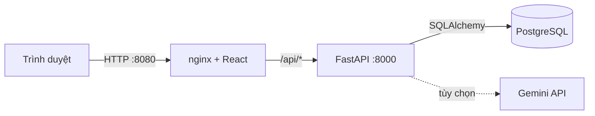
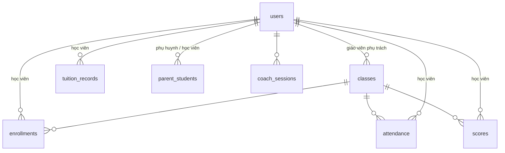

# Hướng dẫn chạy dự án HKII và chuẩn bị thuyết trình

Tài liệu gồm 4 phần: **(1)** chạy dự án, **(2)** kiểm tra nhanh sau khi chạy, **(3)** kịch bản demo 5 phút,
**(4)** câu hỏi thường gặp khi bảo vệ. Bài thuyết trình (slide) nằm ở `docs/HKII-ThuyetTrinh.pptx`.

---

## 1. Chạy dự án

### 1.1 Yêu cầu

| Công cụ | Ghi chú |
|---|---|
| **Docker Desktop** | Bật xong, chờ biểu tượng báo "Engine running" |
| **Git** | Để clone repo |
| RAM trống | Khoảng 2 GB |
| Cổng rảnh | `8080` (web), `8000` (API), `5433` (PostgreSQL) |

Không cần cài Python, Node hay PostgreSQL trên máy: tất cả chạy trong Docker.

### 1.2 Các bước

```bash
git clone https://github.com/laviquyen229/ProjectHKII.git
cd ProjectHKII

# (khuyến nghị) tạo file cấu hình riêng, đổi mật khẩu DB và SECRET_KEY
cp .env.example .env

docker compose up --build
```

- Lần đầu mất vài phút vì phải tải image và cài thư viện.
- Chờ đến khi log của `api` hiện `Application startup complete`. Lúc này API đã tự tạo bảng (Alembic) và nạp dữ liệu mẫu.
- Nếu muốn chạy nền: `docker compose up -d --build`.

> Trên Windows PowerShell, thay `cp` bằng `Copy-Item .env.example .env`.

### 1.3 Địa chỉ sau khi chạy

| Thành phần | Địa chỉ |
|---|---|
| **Giao diện web** | http://localhost:8080 |
| Tài liệu API (Swagger) | http://localhost:8000/docs |
| Kiểm tra sức khỏe API | http://localhost:8000/health |
| PostgreSQL | `localhost:5433`, user/DB/mật khẩu theo `.env` (mặc định `hkii` / `hkii` / `hkii_dev`) |

### 1.4 Tài khoản mẫu

Mật khẩu chung: **`Hkii@12345`** (đặt bằng `SEED_PASSWORD` trong `.env`). Toàn bộ là dữ liệu giả.

| Vai trò | Tên đăng nhập | Ghi chú |
|---|---|---|
| Quản trị viên | `admin` | Toàn quyền |
| Giáo viên | `gv.lan` | Phụ trách IELTS-A1, IELTS-B2 |
| Giáo viên | `gv.minh` | Phụ trách GIAOTIEP-1 |
| Học viên | `hv01` … `hv08` | |
| Phụ huynh | `ph.an` | Con: hv01 |
| Phụ huynh | `ph.ha` | Con: hv02 |

### 1.5 Dừng, chạy lại, xóa dữ liệu

```bash
docker compose stop              # dừng, giữ dữ liệu
docker compose up -d             # chạy lại
docker compose down              # tắt hẳn container, VẪN giữ dữ liệu DB
docker compose down -v           # tắt và XÓA dữ liệu DB (lần sau nạp lại dữ liệu mẫu)
docker compose logs -f api       # xem log API
```

Sửa code backend hoặc frontend xong thì chạy lại `docker compose up -d --build`.

### 1.6 Chạy test

Test dùng SQLite riêng, **không đụng PostgreSQL** (15 test):

```bash
docker compose run --rm --no-deps api python -m pytest -q
```

Kết quả mong đợi: `15 passed`. Test mất khoảng 1 phút vì băm mật khẩu bcrypt cho dữ liệu mẫu ở mỗi test.

### 1.7 Bật AI Coach bằng Gemini (tùy chọn)

Không cần key vẫn chạy (bộ nhận xét theo luật). Muốn dùng Gemini, điền vào `.env`:

```
GEMINI_API_KEY=khoa_cua_ban
```

rồi `docker compose up -d --build`. **Không commit file `.env`** (đã nằm trong `.gitignore`). Nếu Gemini lỗi, hệ thống tự rơi về bộ nhận xét theo luật.

### 1.8 Chạy riêng giao diện để phát triển (tùy chọn)

Cần Node 20+ và API đang chạy ở cổng 8000:

```bash
cd frontend
npm install
npm run dev        # http://localhost:5173, tự chuyển /api sang http://localhost:8000
```

### 1.9 Xử lý sự cố

| Triệu chứng | Nguyên nhân và cách xử lý |
|---|---|
| `failed to connect to the docker API` | Docker Desktop chưa chạy. Mở Docker Desktop, chờ "Engine running", chạy lại lệnh |
| Web báo **502 Bad Gateway** ngay sau khi khởi động | API chưa khởi động xong (đang chạy migration và nạp dữ liệu). Chờ 10–20 giây rồi tải lại |
| `port is already allocated` | Cổng bị chiếm. Đổi trong `.env`: `WEB_PORT=8081`, `API_PORT=8001`, `DB_PORT=5434` |
| Đăng nhập bị báo **423** (khóa tạm) | Nhập sai mật khẩu 5 lần sẽ bị khóa 15 phút. Đợi hoặc `docker compose down -v` để nạp lại dữ liệu |
| Đổi `SEED_PASSWORD` mà không có tác dụng | Dữ liệu mẫu chỉ nạp khi DB còn trống. Chạy `docker compose down -v` rồi `up` lại |
| Muốn làm lại từ đầu | `docker compose down -v && docker compose up --build` |

---

## 2. Kiểm tra nhanh sau khi chạy

```bash
curl http://localhost:8000/health
# {"status":"ok"}

curl -X POST http://localhost:8000/auth/login -H "Content-Type: application/json" \
     -d '{"username":"admin","password":"Hkii@12345"}'
# trả về access_token (JWT) và thông tin người dùng
```

Sau đó mở http://localhost:8080, đăng nhập `gv.lan` và kiểm tra thấy 2 lớp (IELTS-A1, IELTS-B2).

---

## 3. Kịch bản demo 5 phút

Chuẩn bị trước: chạy `docker compose up -d` ít nhất 1 phút trước giờ thuyết trình, mở sẵn 2 tab trình duyệt
(web và Swagger), đăng xuất mọi tài khoản.

| Phút | Việc làm | Điều cần nói |
|---|---|---|
| 0:00–0:30 | Giới thiệu `docker compose up`, mở http://localhost:8080 | "Toàn bộ hệ thống gồm 3 container: PostgreSQL, FastAPI, React sau nginx. Một lệnh là chạy." |
| 0:30–1:30 | Đăng nhập **`gv.lan`**. Mở lớp **IELTS-A1** → tab **Điểm danh** → đổi 1 học viên sang "Vắng" → **Lưu** | "Giáo viên chỉ thấy lớp mình phụ trách. Lưu lại cùng một ngày sẽ cập nhật chứ không tạo trùng." |
| 1:30–2:30 | Tab **Điểm số** → thêm một điểm. Tab **Báo cáo** → bấm **Xuất Excel** | "Báo cáo tính bằng Python (pandas) từ PostgreSQL: chuyên cần và điểm trung bình thang 10." |
| 2:30–3:15 | Đăng xuất, đăng nhập **`ph.an`** → xem **Chuyên cần**, **Điểm số** của con | "Phụ huynh chỉ xem được con mình. Thử truy cập con của người khác sẽ bị chặn 403." |
| 3:15–4:00 | Đăng nhập **`admin`** → **Học phí**: tạo khoản, **Đánh dấu quá hạn**, **Ghi nhận đã đóng** | "Học phí chỉ admin quản lý. Giáo viên không xem được học phí." |
| 4:00–4:40 | Đăng nhập **`hv01`** → **AI Coach**: dán đoạn văn tiếng Anh → **Nhận xét** | "Có Gemini thì dùng Gemini; không có key hoặc lỗi thì tự chuyển sang bộ nhận xét theo luật. Giới hạn 20 lượt/ngày." |
| 4:40–5:00 | Mở http://localhost:8000/docs, bấm thử `/health` | "API tự sinh tài liệu OpenAPI. Toàn bộ backend có 15 test tự động." |

**Phương án dự phòng nếu demo hỏng:** dùng ảnh chụp màn hình trong slide (slide 8–12) và mở Swagger để minh họa API.

---

## 4. Câu hỏi thường gặp khi bảo vệ

**Vì sao chọn FastAPI?**
Tự sinh tài liệu OpenAPI (`/docs`), kiểm tra dữ liệu đầu vào bằng Pydantic, khai báo kiểu rõ ràng, dễ viết test.
Python cũng thuận lợi cho phần AI và báo cáo (pandas).

**Vì sao PostgreSQL mà không dùng Firebase Realtime Database như hệ thống cũ?**
Dữ liệu có quan hệ rõ ràng (lớp – học viên nhiều-nhiều, điểm danh, điểm số, học phí), cần khóa ngoại, ràng buộc duy nhất,
giao dịch (ACID) và truy vấn tổng hợp bằng SQL cho báo cáo. Cây JSON của RTDB phải dựng thủ công những thứ này.

**Bảo mật được làm thế nào?**
Mật khẩu băm bcrypt; đăng nhập trả JWT (HS256, hết hạn sau 8 giờ); khóa tạm 15 phút sau 5 lần sai;
thông báo lỗi đăng nhập gộp chung để không lộ tài khoản có tồn tại; phân quyền theo vai trò kiểm tra ở backend (`deps.py`),
không dựa vào giao diện; khóa và mật khẩu lấy từ biến môi trường, `.env` không được commit.

**Hạn chế còn lại?**
JWT đang lưu ở `localStorage` (có rủi ro XSS, hướng cải thiện: cookie `HttpOnly`); chưa có refresh token; chưa có CAPTCHA;
mật khẩu mẫu chỉ dành cho demo; test chạy trên SQLite chứ không phải PostgreSQL; chưa có test giao diện và CI.

**Dữ liệu mẫu lấy từ đâu?**
Toàn bộ là dữ liệu giả do chương trình tự sinh (`backend/app/seed.py`), không lấy từ hệ thống thật.

**Thay đổi cấu trúc CSDL thì làm thế nào?**
Dùng Alembic: sửa `models.py`, chạy `alembic revision --autogenerate`, commit file migration. Container API tự chạy `alembic upgrade head` khi khởi động.

**Có mở rộng được không?**
API không giữ trạng thái (xác thực bằng JWT), nên có thể chạy nhiều bản sao phía sau nginx hoặc đưa lên Kubernetes;
PostgreSQL có thể chuyển sang dịch vụ quản lý.

**AI Coach hoạt động ra sao?**
Gửi bài viết/bài nói (dạng văn bản) lên `/coach/feedback`. Nếu có `GEMINI_API_KEY` thì gọi Gemini; nếu không có hoặc lỗi thì
dùng bộ nhận xét theo luật (đếm từ, độ dài câu, từ lặp…). Lịch sử lưu trong bảng `coach_sessions`, mỗi người tối đa 20 lượt/ngày.

---

## Phụ lục: kiến trúc




